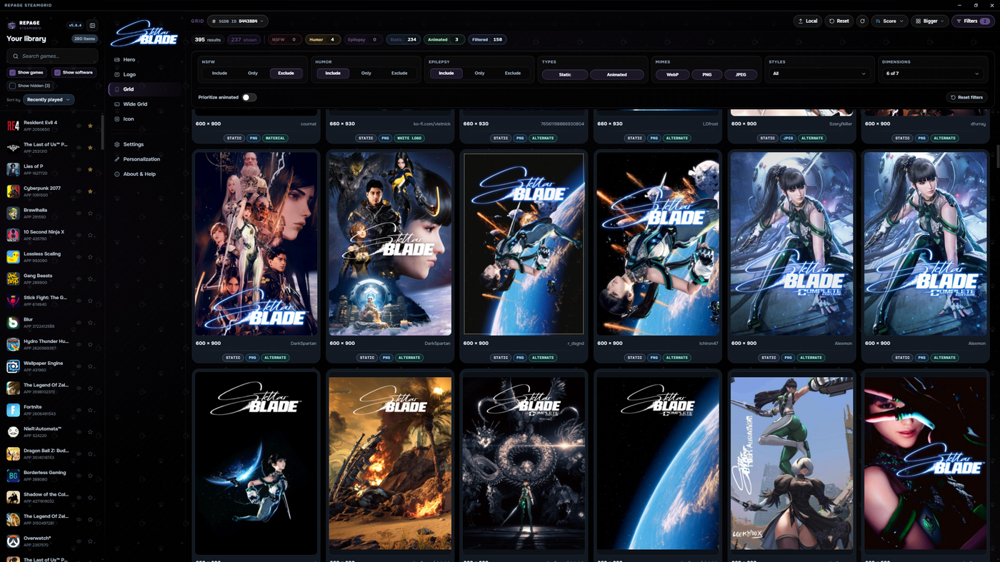
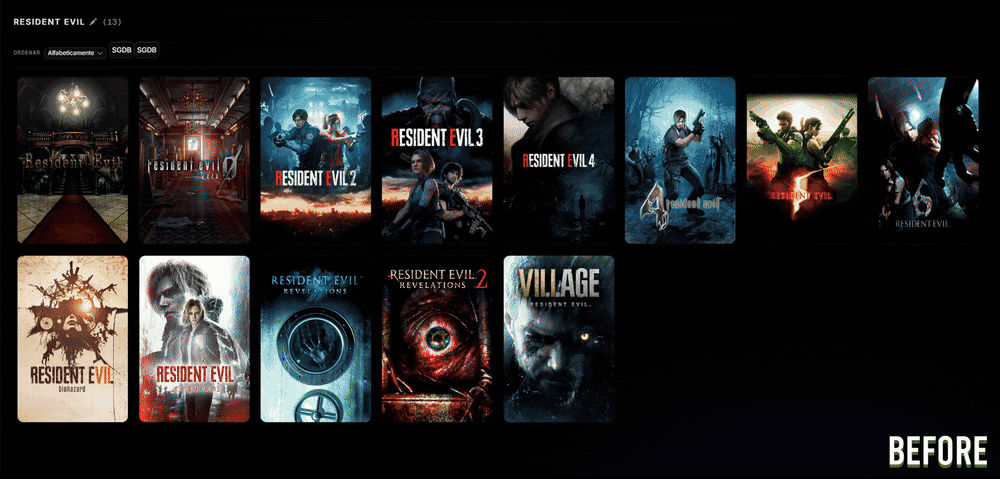
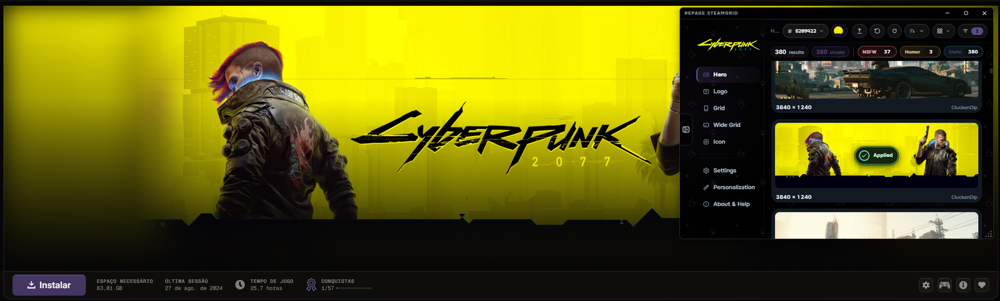
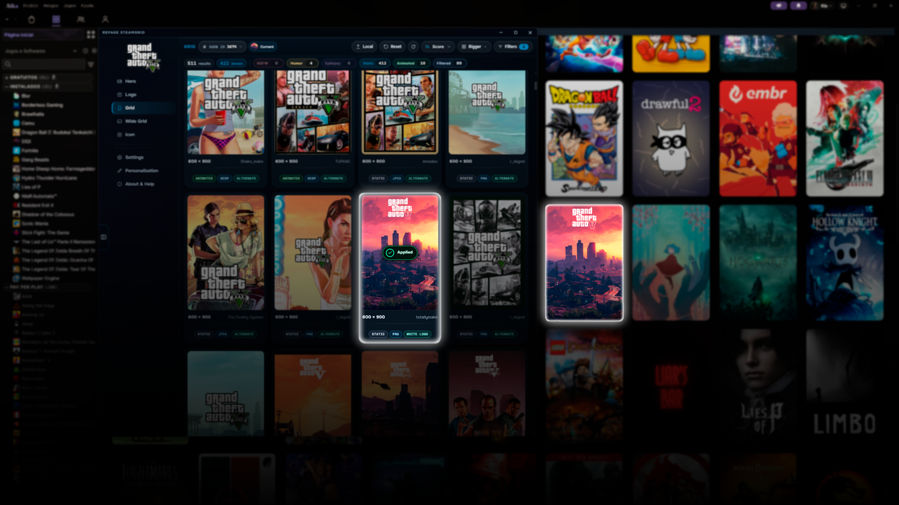
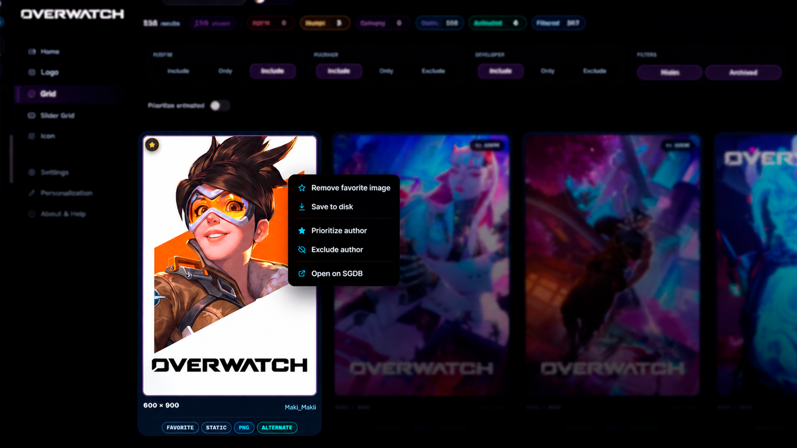
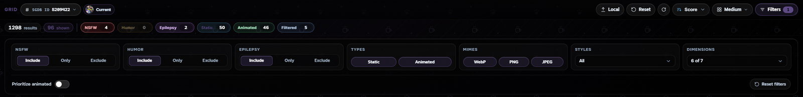
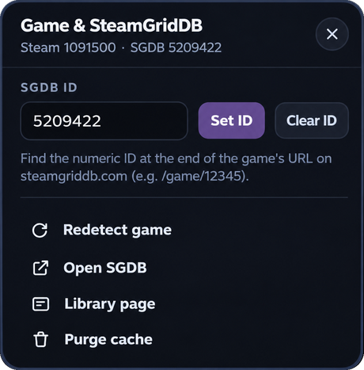
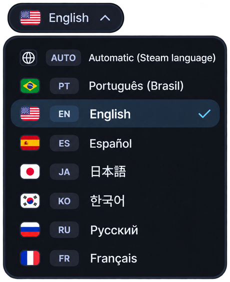

<div align="center">

# Repage SteamGrid

**A complete artwork studio built into Steam.**
Browse, filter, preview and apply SteamGridDB artwork for your entire library, with mouse, keyboard, touch or controller.

[](../../releases/latest)

-2a475e?style=flat-square)
[](LICENSE)

[**Download**](../../releases/latest) · [Installation](#installation) · [API key](#steamgriddb-api-key) · [Filters](#filters) · [Non-Steam games](#non-steam-games-and-the-steamgriddb-id) · [Features](#features) · [Controls](#controls--shortcuts) · [Troubleshooting](#troubleshooting)

</div>

<div align="center">
  
  <br>
  <sub><i>The editor open on a game's Grid tab, with the filter panel, result counters and your library alongside.</i></sub>
</div>

---

## Overview

Repage SteamGrid runs inside the Steam client through [Millennium](https://github.com/SteamClientHomebrew/Millennium) and uses [SteamGridDB](https://www.steamgriddb.com) as its artwork source. It is built around **detailed filtering and sorting**, large libraries, full controller support and a clean, themeable interface.

| | |
| :--- | :--- |
| **One place for everything** | Browse, favorite, save, apply or reset all 5 artwork slots without leaving Steam. |
| **Detailed filters and sorting** | Only / Include / Exclude for NSFW, humor and epilepsy, plus type, format, style, dimensions, four sort orders and animated / resolution priority, all instant. [See how they work](#filters). |
| **Built for big libraries** | Handles hundreds of games and thousands of artworks, with an optional **Performance Mode** for handhelds and low-spec PCs. |
| **Same on every input** | Every feature works with mouse, keyboard, touch, and Xbox / PlayStation / Steam Deck controllers. |
| **Optimized** | Tuned for low memory use and smooth scrolling. Your API key and custom artwork stay on your machine. |

### Compatibility

| System | Status |
| :--- | :--- |
| **Windows 10** | Tested |
| **Windows 11** | Tested |
| **Linux (Ubuntu)** | Tested |
| **Steam Deck** | Prepared, **not tested yet** (alpha) |

> Theme and plugin compatibility cannot be guaranteed for every combination. If something looks off next to a third-party Steam theme or another plugin, please open an issue.

---

## Preview

<div align="center">
  
  <br>
  <sub><i>Batch replace on a whole Steam Collection: 13 games restyled in one pass.</i></sub>
</div>

<br>

<div align="center">
  
  <br>
  <sub><i>Hero artwork applied in real time: the game page updates the moment you click an image.</i></sub>
</div>

<br>

<table>
  <tr>
    <td align="center" width="50%">
      
      <br>
      <sub><i>Grid artwork applied in real time, here running on the <a href="https://github.com/hatewxb/Aika/">Aika</a> theme.</i></sub>
    </td>
    <td align="center" width="50%">
      
      <br>
      <sub><i>Right-click menu: favorite, save to disk, prioritize or exclude an author, open on SGDB.</i></sub>
    </td>
  </tr>
</table>

---

## Installation

### Requirements

- [Steam](https://store.steampowered.com/) with [Millennium](https://github.com/SteamClientHomebrew/Millennium) installed. Flatpak and Snap builds of Steam are not supported by Millennium.
- A free [SteamGridDB API key](#steamgriddb-api-key). Repage cannot load artwork without it.

### Option A: Windows installer (easiest on Windows)

1. Download **`Repage_SteamGrid_Setup.exe`** from the [latest release](../../releases/latest).
2. Run it. The installer finds your Steam and Millennium folders automatically.
3. Click **Install**, then let it start (or restart) Steam when it finishes.

> The installer is **optional** and **Windows only**. It is just a convenient way to install, repair or uninstall. Once Repage is installed you do not need it to stay up to date: see [Updating](#updating-and-uninstalling).

What the installer takes care of:

- **Install, repair and uninstall** (and update, if you prefer) from a single window, in 7 languages.
- **Version check** against the latest GitHub release.
- **Integrity check:** the download is verified with SHA-256 before anything is copied.
- **Safe by design:** files are staged first and the previous version is backed up and restored automatically if something goes wrong. Nothing is touched if a file is locked.
- **Administrator rights only when needed.** Most updates run without a UAC prompt.
- **Millennium setup:** enables the plugin on a fresh install and respects your choice if you had disabled it.
- **Steam control:** can safely close and reopen Steam for you.

> **About the Windows warning.** The installer is not code-signed yet, so Edge and SmartScreen may say the file is "not commonly downloaded". This is expected. To verify your download, compare its hash with the SHA-256 published in the release notes:
>
> ```powershell
> Get-FileHash .\Repage_SteamGrid_Setup.exe -Algorithm SHA256
> ```

### Option B: Manual install (Windows, Linux, Steam Deck)

1. Download `Repage_SteamGrid_x.x.x.zip` from the [Releases](../../releases) page.
2. Extract it into a folder named **`repage-steamgrid`** inside Millennium's `plugins` directory:

   | System | Plugins directory |
   | :--- | :--- |
   | **Windows** | `C:\Program Files (x86)\Steam\millennium\plugins\` (older Millennium versions: `C:\Program Files (x86)\Steam\plugins\`) |
   | **Linux / Steam Deck** (Desktop Mode) | `~/.local/share/millennium/plugins/` |

3. **Linux / Steam Deck only:** run the bundled fix script (see the box below).
4. Restart Steam, open **Millennium → Plugins** and enable **Repage SteamGrid**.

> [!IMPORTANT]
> **Linux / Steam Deck: run `linux-fix.sh` after the first install.**
> In testing, this step was practically **required**: without it the backend may load (`Backend loaded on linux` appears in the Millennium logs) but the Repage UI never shows up.
>
> ```bash
> bash ~/.local/share/millennium/plugins/repage-steamgrid/linux-fix.sh
> ```
>
> Then restart Steam. The script also runs automatically after in-plugin updates, so you only need to do this once by hand.

### First launch

Open Repage SteamGrid with **right-click on any game → Repage SteamGrid → Open**, a double-click on a banner, or `Ctrl + Shift + R`. Then open **Settings**, paste your **SteamGridDB API key** and click **Apply key**.

### Updating and uninstalling

- **Update (recommended, any system):** open Repage, go to the **About** tab and click **Check for updates**. This works the same on Windows, Linux and Steam Deck, verifies the download, and needs no installer. Your settings live in Steam's own storage, not in the plugin folder, so updates keep them.
- **Update via the installer (optional, Windows only):** run `Repage_SteamGrid_Setup.exe` again. It is completely optional and does the same job.
- **Update manually:** extract the new zip over the `repage-steamgrid` folder.
- **Uninstall:** use the installer's uninstall option, or delete the `repage-steamgrid` folder and remove it from Millennium's plugin list.

---

## SteamGridDB API key

Repage gets every image from [SteamGridDB](https://www.steamgriddb.com), and SteamGridDB only answers requests that carry a personal **API key**. The key is **free**, takes about a minute to get, and is the one thing you must set up before Repage can show any artwork.

**Why it matters**

- Without a key, the gallery stays empty: no search, no previews, no downloads.
- It stays on your machine, is used only to talk to SteamGridDB, and is **never** included when you export a backup.

**How to get it**

1. Go to [steamgriddb.com](https://www.steamgriddb.com) and sign in (you can use your Steam account).
2. Open the API page of your preferences directly: [**steamgriddb.com/profile/preferences/api**](https://www.steamgriddb.com/profile/preferences/api). You can also reach it from your profile menu → **Preferences** → **API**.
3. Generate your key if you do not have one yet, then **copy** it.
4. In Steam, open Repage SteamGrid and go to **Settings**.
5. **Paste** the key into the API key field and click **Apply key**.
6. Open any game. Artwork should start loading right away.

**Good to know**

- Treat the key like a password: do not post it in screenshots, issues or videos. If it leaks, generate a new one on the same page and apply it again.
- If nothing loads, check that the key was pasted completely, with no spaces at the start or end, and click **Apply key** again.
- Moving to another PC? Backups do not carry the key, so repeat steps 4 and 5 there.

---

## Filters

Filtering and sorting are at the heart of Repage. Every filter and every sorting option below works **instantly on the results already loaded**, with no extra requests, and a counter bar tells you exactly what you are looking at.

<div align="center">
  
  <br>
  <sub><i>The filter panel, opened with the <b>Filters</b> button. The number on the button shows how many filters are active.</i></sub>
</div>

### Tag filters: NSFW, Humor and Epilepsy

These three work the same way. Each one is a switch with three modes:

| Mode | What you see |
| :--- | :--- |
| **Only** | *Only* images that carry that tag. Everything else is hidden. |
| **Include** | Images with that tag appear normally, mixed with all the others. |
| **Exclude** | Images with that tag are hidden. |

For example, **NSFW: Exclude** keeps adult artwork out of your gallery (and out of your pinned favorites), while **NSFW: Only** is a quick way to review just the flagged images.

### Types, Mimes, Styles and Dimensions

- **Types** and **Mimes** are toggle buttons: **Static** / **Animated**, and the file formats **WebP** / **PNG** / **JPEG**. Click one to turn it off or on.
- **Styles** and **Dimensions** open a checklist. The label reads **All**, or shows how many options are selected (for example *6 of 7*). Everything starts checked, and you untick what you do not want to see.

Use **Reset filters** to bring everything back to the defaults in one click.

### Sorting

Sorting matters as much as filtering. The **sort menu** in the toolbar (it shows the current choice, such as *Score*) sets the order of the **images** in the gallery. It does not sort the filters themselves, but the two work hand in hand: filters decide *which* images appear, and sorting decides *in what order*.

| Option | Order of the images |
| :--- | :--- |
| **Score** | SteamGridDB's own score, highest on top. The site does not document exactly how it is calculated (it likely reflects ratings and popularity), so think of it as the community's pick. |
| **Newest** | Most recent artwork first, going down to the oldest. |
| **Author** | Groups images by author, in alphabetical order. |
| **Resolution** | Highest resolution on top, lowest at the bottom. |

### Priority switches

Two switches work **together with** the sort order instead of replacing it:

- **Prioritize animated:** moves animated artwork to the top. Animated images come first *in the order you chose*, followed by the static ones in that same order. With *Score*, you get the best-scored animated images first and then the best-scored static ones. The same applies to *Newest*, *Author* and *Resolution*.
- **Prioritize resolution** *(Hero tab only)*: works the same way, but moves the highest-resolution banners to the top. It exists only on the Hero tab because resolution matters much more for banners, while on the other tabs most images have very similar sizes.

### Reading the results

- **Counter bar:** shows the total **results**, how many are **shown**, and how many carry each tag (*NSFW*, *Humor*, *Epilepsy*) or type (*Static*, *Animated*). **Filtered** is the number of images your filters are currently hiding, so you always know what you are not seeing.
- **Tag chips:** every card shows chips such as `STATIC`, `PNG`, `ALTERNATE`, `MATERIAL` or `WHITE LOGO`, so you can judge an image without opening it.
- **Card size:** the size menu in the toolbar (*Medium*, *Bigger* and so on) changes the card width, to see more images at once or inspect them closer.

### Curating beyond filters

- **Artist priority:** build an ordered list of authors whose work always comes first.
- **Artist blocking:** exclude an author from tags or straight from the right-click menu of any image.
- **Pinned favorites:** favorite artwork per slot and it stays at the top regardless of sorting or filters.
- **Local files first:** your own files stay pinned at the top of the slot.
- **Portable:** filters and curation settings are included in the JSON backup, so you can move them between machines. Your API key never is.

---

## Non-Steam games and the SteamGridDB ID

Steam games are matched to SteamGridDB by their Steam App ID, which is the same for everyone. **Non-Steam shortcuts** (emulators, games from other launchers, standalone executables) have no shared ID, so Repage **searches by the game's name automatically**.

Most of the time that is all you need. But a name can match the wrong game, or nothing at all. If the artwork that appears is not from the right game, or the **SGDB ID** is empty, set the ID yourself.

<div align="center">
  
  <br>
  <sub><i>The <b>Game &amp; SteamGridDB</b> panel. Open it from the <b>SGDB ID</b> chip at the top left of the toolbar.</i></sub>
</div>

### How to find the ID

1. Open [steamgriddb.com](https://www.steamgriddb.com) in your browser and search for the game.
2. Open the page of the **correct** game.
3. Look at the address bar. The **number at the end of the URL is the game's ID**.

```text
https://www.steamgriddb.com/game/38652
                                 └─ 38652 is the game ID
```

### How to use it

1. In Repage, select the game and click the **SGDB ID** chip at the top left of the toolbar.
2. Type the ID into the **SGDB ID** field and click **Set ID**.
3. The gallery reloads with that game's artwork.

Your choice is saved as an override for that game, and it is included in your JSON backup. To go back to automatic matching, click **Clear ID**, and if you lose track of the number, **Redetect game** brings back the right one.

The same panel has a few more tools:

| Action | What it does |
| :--- | :--- |
| **Redetect game** | Gets the ID again automatically: by the game's **name** for non-Steam shortcuts, or by its **Steam App ID** for Steam games. Handy if you cleared or changed the number and do not remember what it was. |
| **Open SGDB** | Opens the game's page on the official SteamGridDB site, in your browser. |
| **Library page** | Takes you to the game's page in your Steam library, the one with the banner, the Play button and the rest. |
| **Purge cache** | Clears the cached data related to this game, so it is fetched again. |

> **Tip:** this also fixes the occasional Steam game whose artwork is mixed up or missing. Find the right page on SteamGridDB and set its ID the same way.

---

## Features

<details open>
<summary><b>Complete artwork control</b></summary>

- **All 5 Steam slots:** vertical **Grids**, **Wide Grids**, **Heroes**, **Logos** and **Icons**, for Steam games and non-Steam shortcuts.
- **Live preview** of what is currently applied before you replace or reset it.
- **Local files:** apply your own `.png`, `.jpg`, `.webp`, `.gif`, `.ico` or `.webm`. Local files stay pinned at the top of their slot.
- **Save to disk:** right-click any image (or press `X` on a controller) to download it to a folder of your choice or to Downloads.
- **Official fallback:** restore Steam's original store assets with **Set to Steam Assets** or **Reset**.

</details>

<details open>
<summary><b>Smart opening and bulk automation</b></summary>

- **Context-aware tabs:**
  - Double-click a game's library banner → **Hero**
  - Right-click a vertical library cover → **Grid**
  - Right-click a horizontal cover (Recent, Featured, Big Picture) → **Wide Grid**
  - Right-click a game in the library sidebar → **Icon**
  - `Ctrl + Shift + R` (or `R2/RT + L3 + R3`) anywhere → toggle the editor on the current game
- **Auto Replace and collection tools:** replace all artwork for one game in a click, or batch replace / reset whole Steam Collections by artwork type, skipping anything on your **Excluded APPIDs** list.
- **Wrong match?** Search by name or type any numeric **SteamGridDB ID** straight into the toolbar.

</details>

<details>
<summary><b>Calm animated cards</b></summary>

`.webm`, `.webp` and `.gif` artwork shows a still first frame and only animates on hover or controller focus, which keeps big galleries smooth and easy on the eyes.

</details>

<details>
<summary><b>Library organizer and backups</b></summary>

- **Library sidebar:** filter by *Games*, *Software*, *Tools* or *Hidden*, star favorites, hide games, and sort by *Alphabetical*, *Recently Played*, *Hours Played*, *Disk Space* or *Acquisition Date*.
- **Quick jump:** open any game's Library page in the background while the editor stays open.
- **Portable backups:** export and import your configuration (filters, theme presets, favorite games, favorite artwork, hidden games and SGDB ID overrides) as JSON. Your API key is never exported.

</details>

<details>
<summary><b>Themes, languages and accessibility</b></summary>

- **12 curated themes plus custom presets:** *Fluxuos Core* (an OLED theme with a subtle café pattern and cozy audio), *Steam Blue*, *Midnight*, *Midnight OLED*, *Nordic Frost*, *Crimson Velvet*, *Night City Neon*, *Umbrella Kiss*, *Bonnie & Clyde*, *The Green Hero*, *Firefly Glow* and *Cassino Inkwell*. Tweak lights, surfaces and corners, and save up to 9 presets of your own.
- **7 languages with auto-detection:** English, Portuguese (Brazil), Spanish, Japanese, Korean, Russian and French. The default is **Automatic**, which follows your Steam language, and you can pick another one in **Settings**.

<div align="center">
  
</div>

- **Adaptive keyboard and audio:** uses Steam's keyboard in Big Picture and on Steam Deck, Repage's own controller keyboard on desktop, plus subtle UI sounds you can turn off.

</details>

---

## Controls & Shortcuts

| Action | Keyboard / Mouse | Controller |
| :--- | :--- | :--- |
| **Open / close panel** | `Ctrl + Shift + R` (customizable from the menu) or double-click a banner | `R2/RT + L3 + R3` |
| **Navigate** | Arrow keys / Mouse | D-Pad / Left Stick |
| **Scroll gallery / page** | Mouse Wheel / `PageUp` / `PageDown` | Right Stick |
| **Cycle NSFW mode** | Click the NSFW switch | `L2 / LT` |
| **Cycle sort order** | Click the sort menu | `R2 / RT` |
| **Apply artwork** | Left Click / `Enter` / `Space` | `A` (Cross) |
| **Image menu / Save to disk** | Right Click / `Shift + F10` | `X` (Square) |
| **Show / hide filters** | Click **Filters** | `Y` (Triangle) |
| **Switch tabs** | `Ctrl + PageUp / PageDown` | `LB / RB` (`L1 / R1`) |
| **Collapse / expand library** | `B` | `R3` (Right Stick Click) |
| **Jump to library top** | `Home` (in list) | `L3` (Left Stick Click) |
| **Back / close menu or panel** | `Esc` | `B` (Circle) |

**Cycling with the triggers.** `L2 / LT` steps the NSFW filter through **Include → Only → Exclude** and back to Include. `R2 / RT` steps the sort order through **Score → Newest → Author → Resolution** and back to Score.

---

## Troubleshooting

<details>
<summary><b>No artwork loads / the gallery is empty</b></summary>

Almost always a missing or incomplete [SteamGridDB API key](#steamgriddb-api-key). Open **Settings**, paste the full key with no extra spaces and click **Apply key**.

</details>

<details>
<summary><b>A non-Steam game shows the wrong artwork, or nothing</b></summary>

Non-Steam shortcuts are matched by name, which can miss. Find the game on [steamgriddb.com](https://www.steamgriddb.com), copy the number at the end of its URL (for example `.../game/38652`), click the **SGDB ID** chip at the top left of the toolbar, enter the number and click **Set ID**. See [Non-Steam games and the SteamGridDB ID](#non-steam-games-and-the-steamgriddb-id).

</details>

<details>
<summary><b>The plugin does not show up in Steam</b></summary>

Make sure the folder is named exactly `repage-steamgrid`, that it sits directly inside Millennium's `plugins` folder, and that the plugin is enabled under **Millennium → Plugins**. Restart Steam afterwards.

</details>

<details>
<summary><b>The UI does not appear on Linux / Steam Deck</b></summary>

Run `linux-fix.sh` once and restart Steam (see the [Linux / Steam Deck box](#option-b-manual-install-windows-linux-steam-deck) in the installation steps):

```bash
bash ~/.local/share/millennium/plugins/repage-steamgrid/linux-fix.sh
```

</details>

<details>
<summary><b>The installer says a file is locked</b></summary>

Another program (usually Steam itself, or an editor with a plugin file open) is using the plugin's files. Close it and try again. The installer also offers a **Close Steam and retry** button. Nothing is changed while a file is locked.

</details>

<details>
<summary><b>The installer reports an error</b></summary>

Use the **Copy log** button on the error screen and attach it when you open an issue. The log is also saved at `%TEMP%\Repage_SteamGrid_Setup.log`.

</details>

<details>
<summary><b>I cancelled the administrator prompt (UAC)</b></summary>

Nothing is installed or removed. Run the action again and accept the prompt, or use the manual install.

</details>

---

## Plugin Structure

```text
repage-steamgrid/
├── .millennium/dist/index.js   # Compiled frontend bundle
├── backend/
│   ├── main.lua                # SteamGridDB API proxy, download cache and file I/O
│   └── icons.lua               # Icon writer and original backup restoration
├── plugin.json                 # Millennium plugin manifest
├── metadata.json               # Plugin version metadata
├── linux-fix.sh                # Linux / Steam Deck first-install helper
├── README.md                   # Overview and documentation
├── INSTALLATION.txt            # Quick installation and controls guide
├── PATCH_NOTES.txt             # Version history
├── CREDITS.md                  # Acknowledgments
└── LICENSE                     # MIT License
```

---

## Credits

- **Klastein**: architecture, rebuild, UI/UX, controller engine and ongoing development.
- **luthor112**: creator of the original [Easy SteamGrid](https://github.com/luthor112/steam-easygrid).
- **ShuriZma**: special thanks, as credited in the original project.
- **[SteamGridDB](https://www.steamgriddb.com)**: community artwork database and API. Please respect and credit the artists.
- **[Millennium](https://github.com/SteamClientHomebrew/Millennium)**: Steam client plugin framework.
- **hatewxb ([Aika theme](https://github.com/hatewxb/Aika/))**: visual inspiration for the ambient light and color-token concepts.

## License

Released under the [MIT License](LICENSE).
